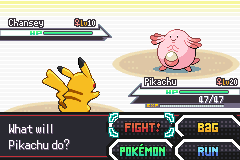
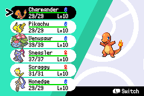

# Legends Awakening Reborn

A Pokémon Emerald fan project with an original rift-centered story, speaking protagonists, connected regional adventures, and modern battle and training systems.

Play as **Aren or Aria** as a strange dream leads into a growing investigation across Hoenn and beyond. Familiar characters, new research, and encounters with allied villain factions connect the journey, while custom maps, portraits, and interfaces give the game its own identity.

Built on **RHH's pokeemerald-expansion** and pret's Pokémon Emerald decompilation. A verified 1.17.2 engine integration is available on the separate [update/expansion-1.17.2 branch](https://github.com/HeroSigma/Legends-Awakening-Reborn/tree/update/expansion-1.17.2).

**Status:** In active development. The current build includes playable story chapters and integrated regional content; the full planned story and every imported region are not complete. See the [story implementation guide](docs/story/planning/Legends_Awakening_Story_Planning_Guide.md) for the detailed, spoiler-filled breakdown.

## A look at the game

| Battle interface | Party menu |
| --- | --- |
|  |  |

## What makes Reborn different

- **An authored story with a speaking player.** Aren and Aria take part in conversations, with character portraits, speaker colors, staged scenes, and a continuing rift investigation.
- **A wider world.** Imported and adapted maps support regional exploration beyond Hoenn. Wild encounters use regional families, habitats, time of day, and progression rules. Regional content is at different stages of completion.
- **Nine starter choices.** The starter briefcase expands the opening selection, and rival dialogue recognizes the chosen partner.
- **Competitive trainer teams.** Themed teams, legal movesets, story-based level caps, and eligible Singles/Doubles choices for Gym and League battles. Early scripted encounters retain their authored teams and formats.
- **Modern battle mechanics.** Mega Evolution, Z-Moves, Terastallization, and Dynamax integrate with story unlocks, compatible items, and trainer rules.
- **Quests and rift research.** Track main and side objectives, claim rewards at their intended locations, and unlock research tools through the story. Quests replace the earlier Journal system.
- **More ways to travel.** Preferred followers, ground and water mounts, and Fly-gated low flight work alongside terrain and story restrictions. Acquired field skills can use eligible party Pokémon without taking up battle move slots.
- **A custom presentation.** A rift title screen, BW-style battles, coordinated teal Sword & Shield-style menus, speaker portraits, and protagonist outfit and palette options.
- **Convenient training and inventory.** Summary-screen stat editing, training services, bulk training items, thirteen bag categories, automatic fishing, portable breeding, and an egg nursery, with feature-specific progression requirements.
- **Optional collection storage.** Choose normal 14-box storage or compact 60-box storage with room for 1,800 Pokémon. Read the storage notes before switching.

Feature behavior, unlock conditions, credits, and validation records are documented under [docs/features](docs/features).

## Build the game

Follow the operating-system setup in [INSTALL.md](INSTALL.md) to install the required toolchain. WSL/Linux is the verified build environment for the current integration.

Clone the complete project from the default branch:

```sh
git clone --branch main https://github.com/HeroSigma/Legends-Awakening-Reborn.git
cd Legends-Awakening-Reborn
make -j4
```

The build produces `pokeemerald.gba` in the repository root. Open it in a GBA emulator. The default branch, `main`, contains the consolidated project. The older `feature/compact-pc-60-boxes` branch is retained as a storage extraction reference.

## Saves and storage

Keep a backup of your battery save before updating builds. Use the emulator's normal in-game save and load process; old emulator save states can be incompatible with a changed runtime.

The 1.17.2 integration preserves Pokémon record sizes, save-block sizes, storage size, and story flag/variable offsets. A copy of the existing player save passed compatibility checks. These checks do not promise compatibility with every older development build or saves from other games.

**Changing PC storage modes clears boxed Pokémon after two confirmations.** Party Pokémon and story progress remain. Collection mode simplifies some Pokémon metadata and disables certain side activities. See the [storage behavior and porting notes](docs/compact-pc/README.md) and [expanded inventory/save format](docs/features/expanded-bag-storage.md) before changing modes or moving between builds.

## Project documentation

| Topic | Reference |
| --- | --- |
| Engine update and regression results | [Expansion 1.17.2 integration branch notes](https://github.com/HeroSigma/Legends-Awakening-Reborn/blob/update/expansion-1.17.2/docs/updates/expansion-1.17.2.md) |
| Story scope and characters — spoilers | [Story planning guide](docs/story/planning/README.md) |
| Current quests and field tools — spoilers | [Quest system](docs/features/quests/README.md) |
| Trainer teams, caps, and battle formats | [Competitive trainers](docs/features/competitive-trainers.md) |
| Dynamax unlocks and battle controls | [Dynamax Band](docs/features/dynamax-band.md) |
| Regional encounter distribution | [Regional wild pools](docs/la_world/wild_pools/regional-distribution.md) |
| Field skills and traversal | [Field skills](docs/features/field-move-unlocks.md) · [PokeRide](docs/features/pokeride/README.md) |
| Repository recovery and preserved work | [Transfer report](docs/repository-transfer/README.md) |

The engine integration passed a production build and eight focused native mGBA suites covering storage/save/menu behavior, Dynamax, quests, story continuity, existing-save compatibility, overworld resource pressure, Ashes/Silph scenes, and both protagonists' prologues. This is regression coverage for the integrated build, not a claim that every map or battle has been exhaustively tested.

## Credits

Legends Awakening Reborn is developed in the [HeroSigma repository](https://github.com/HeroSigma/Legends-Awakening-Reborn), with code and artwork adapted from community projects.

- **Engine and decompilation:** [RHH / pokeemerald-expansion](https://github.com/rh-hideout/pokeemerald-expansion), [pret / pokeemerald](https://github.com/pret/pokeemerald), and the contributors in [CREDITS.md](CREDITS.md).
- **World and regional assets:** See the preserved [Heart & Soul credits](docs/la_world/hns_regions/CREDITS.md) and [upstream credits](docs/la_world/hns_regions/UPSTREAM-CREDITS.md).
- **Interfaces and shared artwork:** Attribution and source revisions are retained in the [BW battle UI](docs/features/bw-battle-ui/README.md), [Sword & Shield bag](docs/features/swsh-bag/README.md), [party menu](docs/features/swsh-party-menu/README.md), [quest](docs/features/quests/README.md), and [Aqua asset](docs/art/aquas_assets/README.md) documentation.
- **Ride system and art:** See [PokeRide credits](docs/features/pokeride/README.md).

These links are entry points, not an exhaustive replacement for the per-feature credits and source records. Preserve those attributions when reusing project material.

Pokémon and related characters belong to their respective owners. This is an unofficial fan project. This repository does not include a playable ROM or player save.
